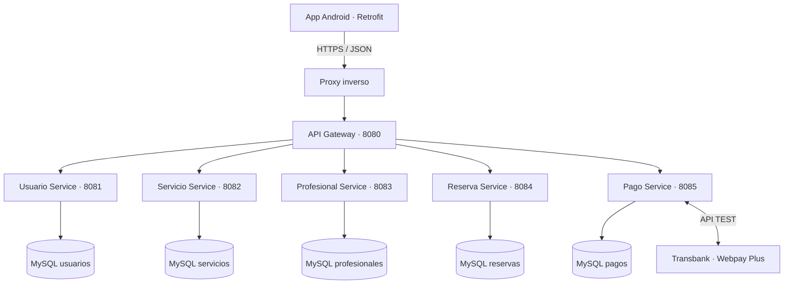
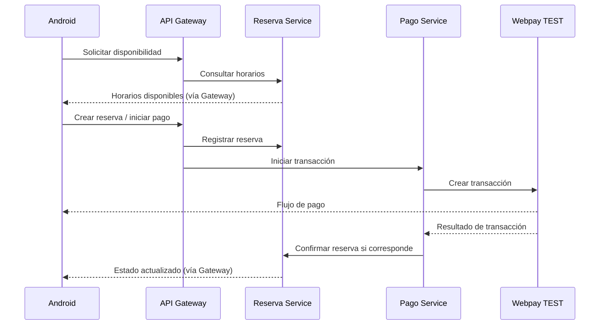

# SanaEsencia — Backend de microservicios

Backend REST de **SanaEsencia**, una aplicación Android para gestionar usuarios, profesionales, prestaciones, horarios, reservas y pagos de un centro de bienestar.

Este backend está desarrollado principalmente con **Java 21 y Spring Boot**, utiliza **MySQL 8.4** para persistencia y se despliega mediante **Docker Compose** en una instancia **Amazon EC2 con Ubuntu**. La aplicación Android, desarrollada con Kotlin y Jetpack Compose, consume sus endpoints mediante Retrofit.

> **Estado:** MVP funcional en pruebas. La integración con **Webpay Plus** utiliza el **ambiente TEST de Transbank**; no procesa pagos reales.

## Arquitectura



El **API Gateway** centraliza las solicitudes externas y las deriva al microservicio responsable. Cada servicio de negocio administra su propia base de datos; las referencias entre dominios se gestionan por identificadores y comunicación entre servicios, sin relaciones JPA que crucen sus bases de datos.

## Tecnologías

| Capa | Tecnologías |
|---|---|
| Lenguaje y framework | Java 21, Spring Boot, Maven |
| API | Spring Web, REST, JSON |
| Persistencia | Spring Data JPA, MySQL 8.4 |
| Seguridad | Spring Security, JWT, validaciones de entrada |
| Infraestructura | Docker, Docker Compose, Ubuntu, Amazon EC2 |
| Acceso externo | API Gateway, dominio DuckDNS, proxy inverso y HTTPS |
| Integraciones | SMTP para recuperación de contraseña, Transbank Webpay Plus TEST |

## Microservicios

| Componente | Puerto | Responsabilidad |
|---|---:|---|
| `api-gateway-sanaesencia` | 8080 | Punto de entrada y enrutamiento |
| `usuario-service-sanaesencia` | 8081 | Registro, inicio de sesión, JWT, perfil y recuperación de contraseña |
| `servicio-service-sanaesencia` | 8082 | Especialidades y prestaciones |
| `profesional-service-sanaesencia` | 8083 | Profesionales, especialidades y modalidades |
| `reserva-service-sanaesencia` | 8084 | Disponibilidad, creación, consulta y cancelación de reservas |
| `pago-service-sanaesencia` | 8085 | Transacciones, resultados de pago y sincronización de reservas |

También existe el repositorio `transbank-service-sanaesencia` dentro del trabajo del proyecto. **Su función y despliegue exactos deben verificarse en su código actual antes de documentarlos como un servicio independiente en ejecución.**

> Los puertos indicados corresponden a la configuración de desarrollo/despliegue utilizada en el proyecto. No todos deben exponerse públicamente: el acceso externo debe realizarse a través del proxy y el Gateway.

## Bases de datos

Cada microservicio administra su propio esquema:

| Base de datos | Tablas principales |
|---|---|
| `sanaesencia_usuarios` | `usuarios` |
| `sanaesencia_servicios` | `especialidades`, `servicios` |
| `sanaesencia_profesionales` | `profesionales`, `profesional_especialidades`, `profesional_modalidades` |
| `sanaesencia_reservas` | `reservas`, `horarios_atencion` |
| `sanaesencia_pagos` | `pagos`, `devoluciones` |

La tabla `devoluciones` tiene una clave foránea `pago_id` hacia `pagos`. Los datos de usuarios, reservas y pagos se mantienen separados de los catálogos de profesionales, prestaciones y horarios.

## Funcionalidades implementadas

### Usuarios y autenticación

- Registro con validación de datos personales.
- Inicio de sesión mediante correo y contraseña.
- Emisión y validación de JWT para operaciones protegidas.
- Consulta y actualización del perfil.
- Recuperación de contraseña por correo electrónico.
- Enlace de restablecimiento con token de **30 minutos** de vigencia.
- Manejo de errores HTTP y respuestas comprensibles para el frontend.

### Profesionales y prestaciones

- Consulta de especialidades y prestaciones.
- Consulta de profesionales y sus especialidades.
- Modalidades de atención **presencial** y **online**.
- Consulta de horarios disponibles.

### Reservas

- Creación y consulta de reservas.
- Confirmación de reservas asociadas a pagos aprobados.
- Historial de reservas y consulta de estados.
- Cancelación de reservas confirmadas, conservando su registro como `CANCELADA`.
- Liberación del horario cuando corresponde.
- Validación **en el backend** que impide cancelar una reserva confirmada cuando faltan menos de **12 horas** para la atención.

### Pagos

- Inicio de transacciones con Webpay Plus TEST.
- Verificación del resultado del pago.
- Sincronización entre el estado del pago y el de la reserva.
- Manejo de procesos de pago aprobados, rechazados o anulados.
- Persistencia de pagos y estructura para devoluciones.

> La política de devolución de dinero por cancelación **no está definida** para este MVP y debe acordarse con el cliente. No se debe asumir un reembolso automático.

## Flujo general de una reserva



*Diagrama conceptual: las rutas y llamadas concretas deben contrastarse con los controladores y clientes HTTP de cada servicio.*

## Seguridad y criterios de diseño

- **JWT** en las solicitudes autenticadas mediante `Authorization: Bearer <token>`.
- **DTO** para delimitar los datos recibidos y devueltos por los endpoints.
- Validaciones de entrada y manejo centralizado de excepciones.
- Contraseñas almacenadas mediante un algoritmo de hash, no en texto plano.
- Restricciones de negocio verificadas en el backend, además de reflejarse en Android.
- Servicios y bases de datos separados por responsabilidad.


## Organización de repositorios

El backend se ha desarrollado en **repositorios Git independientes**. Una organización local de trabajo puede ser:

```text
Microservicios/
├── README.md                      # Documentación general del backend
├── api-gateway-sanaesencia/
├── usuario-service-sanaesencia/
├── servicio-service-sanaesencia/
├── profesional-service-sanaesencia/
├── reserva-service-sanaesencia/
├── pago-service-sanaesencia/
└── transbank-service-sanaesencia/
```

## Requisitos de ejecución

- Java 21 y Maven para compilar los servicios fuera de Docker.
- Docker Engine y Docker Compose para ejecutar el conjunto.
- Acceso a los repositorios de los microservicios.
- Archivo `compose.yaml`/`docker-compose.yml` configurado para el entorno.
- Configuración de conexión a MySQL, JWT, SMTP y Webpay TEST según corresponda.


### Despliegue en AWS

El entorno de pruebas utiliza una instancia EC2 Ubuntu con los contenedores del backend y MySQL. El acceso desde Android se realiza mediante un dominio DuckDNS y un proxy inverso hacia el API Gateway.

## API y documentación de endpoints

Los siguientes endpoints de **usuarios** corresponden a las rutas conocidas del proyecto. Deben validarse contra la versión desplegada si se modifican los controladores o el Gateway.

| Método | Ruta del servicio de usuarios | Función |
|---|---|---|
| `POST` | `/api/usuarios/registro` | Registrar usuario |
| `POST` | `/api/usuarios/login` | Autenticar usuario |
| `GET` | `/api/usuarios/perfil` | Consultar perfil |
| `PATCH` | `/api/usuarios/perfil` | Actualizar perfil |
| `POST` | `/api/usuarios/recuperacion` | Solicitar recuperación |
| `POST` | `/api/usuarios/nueva-contrasena` | Establecer nueva contraseña |

Ejemplo de inicio de sesión en un entorno local con el Gateway en el puerto 8080:

```bash
curl -X POST http://localhost:8080/api/usuarios/login \
  -H "Content-Type: application/json" \
  -d '{"correo":"usuario@ejemplo.com","password":"TU_CONTRASENA"}'
```

Las rutas de servicios, profesionales, reservas y pagos deben documentarse a partir de sus controladores reales; no se inventan aquí nombres de endpoints ni contratos de DTO.

## Pruebas recomendadas

- Registro de usuarios y validaciones de datos.
- Login exitoso y credenciales inválidas (respuesta `401`).
- Consulta y modificación de perfil con JWT.
- Recuperación de contraseña y expiración del enlace.
- Listado de profesionales, especialidades y prestaciones.
- Consulta de horarios y creación de reservas.
- Pago aprobado y confirmación de reserva.
- Pago rechazado o anulado sin confirmar indebidamente la reserva.
- Cancelación con más de 12 horas de anticipación.
- Rechazo de cancelación con menos de 12 horas.
- Liberación y reutilización de horarios.
- Repetición de callbacks de pago sin duplicar efectos.
- Manejo de errores de conexión y respuestas del servidor.

### Tarjetas de prueba

Utiliza **únicamente las tarjetas oficiales del ambiente de integración** publicadas por Transbank. Consulta la documentación actualizada en [Transbank Developers](https://www.transbankdevelopers.cl/).

## Estado y alcance

SanaEsencia es un **MVP académico y demostrativo** en etapa de validación. Su prioridad es comprobar el funcionamiento de extremo a extremo de los flujos de usuario, reservas y pagos.

Posibles mejoras futuras, sujetas a requerimientos del centro:

- Integración con plataformas externas de gestión clínica.
- Panel administrativo y gestión avanzada de agendas.
- Notificaciones y recordatorios.
- Mayor cobertura de pruebas automatizadas y observabilidad.
- Definición e implementación de políticas de devolución.
- Endurecimiento de configuración y despliegue para producción.
